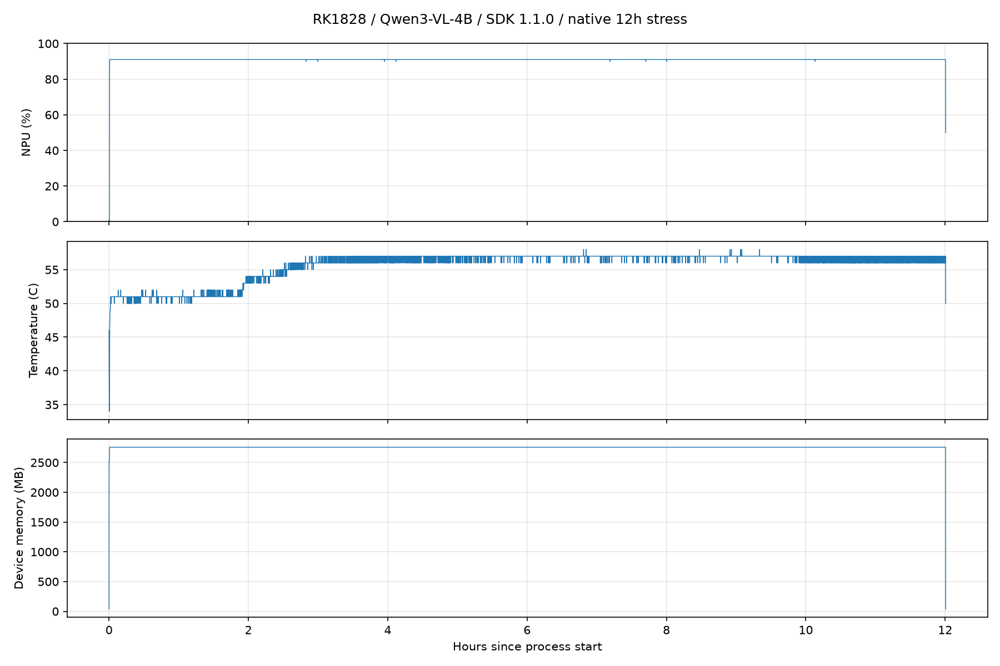

# SDK 1.1.0 原厂 12 小时压力测试报告

[报告索引](README.md) · [原厂性能对照](native-comparison.md)

北京时间：2026-10-12 16:55:01 至 2026-10-13 04:55:29。

## 结果

原厂工具正常退出（exit 0），达到计划时限；完成 21793 轮，SDK 错误标记 0，采样失败 0。工具推理计时 43200.712 秒（12 小时 0.712 秒）；进程及编排墙钟 43227.594 秒，包含加载与收尾。逐轮 STAGE 完成标记 21793 个。

## 配置

RK3588 + RK1828 M.2；官方 v1.1.0 Qwen3-VL-4B，Runtime / 固件 1.1.0；NPU 启动前确认 850MHz、PERFORMANCE，全核 0xff；CPU performance，结束后只读检查三组 governor 均已恢复 schedutil。视觉 384×384，ctx1024，固定 demo.jpg 与短描述提示词，每轮视觉和语言各一次。原厂命令 -tl 12，完整参数保存在本地 results/native-stress-12h-20261012/status.json。未连续记录频率，不能据此排除所有瞬时降频。

## 资源采样

有效采样 8338 次；等待间隔 5 秒另加采集耗时，统计覆盖加载及收尾，不是连续时间积分。

| 指标 | 结果 |
| --- | --- |
| NPU 样本均值 / 峰值 | 90.933% / 91% |
| NPU ≥90% 样本比例 | 99.916% |
| 温度范围 / 最高 | 34–58℃ / 58℃ |
| 设备内存首 / 峰 / 尾 | 36 / 2757 / 36 MB（总计5120MB） |
| Host MemAvailable 首 / 最低 / 尾 | 7461.5 / 7262.8 / 7478.9 MiB |

## 原生性能与限制

原厂末次汇总：Vision 115 ms、TTFT 132.749 ms、Decode 85.039 token/s、GenLen 147 token。这些是末次值，不能称全程均值或 P95。TotalRuns / TotalTime 约 0.5045 原生循环/秒，只描述固定图完整生成循环，不是业务图片吞吐或视频 FPS。没有逐轮 token 统计，不以末次 GenLen 推算全程输出 token/s。

此次为固定图原生老化，不是业务准确率、最大并发、满内存或持续100% NPU验证。日志正常完成表示工具未报推理失败，不代表回答语义正确。无自动重启；停止原因为达到 -tl 12 时限。此前主动停止的30分钟任务不拼接进入本次成绩。

## 原始文件

本地 `results/native-stress-12h-20261012/` 保留 status.json、stress.log、telemetry.jsonl 和分析脚本。公开仓库仅保存[统计摘要](../data/native-stress-12h/analysis.json)与资源曲线，不上传完整原始日志和逐次遥测。完成后 transient systemd 单元已回收；CPU 恢复由实际读取确认。

统计均值覆盖加载与收尾，未剔除低负载样本。全程仅记录阶段完成进度和末次性能汇总，无法提供全程 TTFT、Decode 或端到端 P50/P95/P99。Host 可用内存变化包含其他系统活动，不能单凭此判断模型泄漏。
